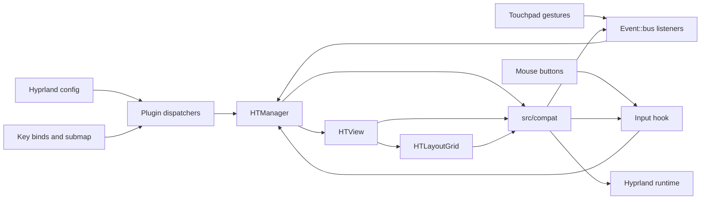
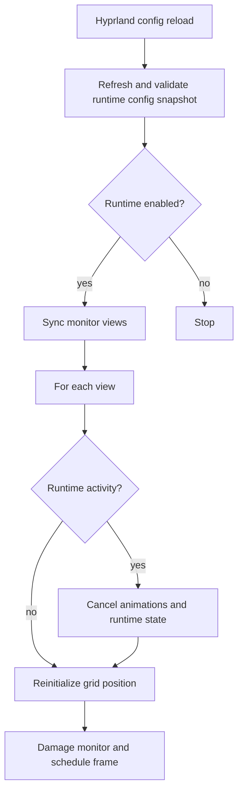

# Architecture

Hyprtasking is intentionally narrow on the
[supported Hyprland targets](compat-contract.md).
The public surface is the overview itself, mouse interaction, gestures, the
core dispatchers, runtime health, and audited compat wrappers.

## Runtime Surface

Supported dispatchers:

- `hyprtasking:toggle`
- `hyprtasking:move`
- `hyprtasking:select`
- `hyprtasking:commit`
- `hyprtasking:health`

Bare arrow keys and Enter are supported only through the `hyprtasking` submap.
The plugin enters that submap when a view becomes interactively active and
returns to the default submap when all views leave that state.

Event::bus listeners are installed through `src/compat/runtime_compat.cpp` for
mouse movement, gestures, config reloads, and monitor changes. Missing listener
registration is treated as a startup failure and shows up in the
`disable_reason` and `failure_source` fields of `hyprtasking:health`.

## Reload Lifecycle

Reload behavior is deliberately not configurable. A reload always leaves each
view in a clean grid position, and any active, closing, or navigating overview
state is canceled before rendering continues.

Config is read into a typed runtime snapshot at startup, config reload, and
runtime readiness checks that can observe transient `hyprctl keyword` changes.
Invalid values are handled as described in the
[README](../README.md#config-options).

The release gate (`scripts/release-check.sh`) is described in the
[debugging playbook](debugging-playbook.md#7-release-gate).
