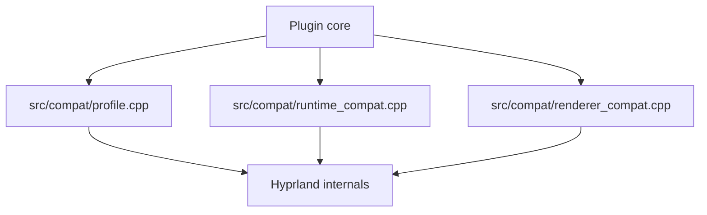

# Compat Contract

Hyprtasking hard-gates runtime activation to explicit, audited Hyprland
versions.

| Version | CI coverage |
| --- | --- |
| `0.55.x` | offline compat gate on `v0.55.0`; local runtime smoke checked on `0.55.2` |
| `0.56.0` | offline compat gate |
| `0.56.2` | offline compat gate; live rendering smoke checked |

The runtime shape is diagrammed in [`architecture.md`](architecture.md).

## Update Workflow

1. Build against the installed `hyprland` package headers only. A Hyprland
   source tree is for auditing, never for building.
2. Confirm the installed package and the live runtime are on the same supported
   version: `bash scripts/check-version-contract.sh`.
3. Audit each supported source tree:

   ```bash
   RELEASE_MODE=offline HYPRLAND_SOURCE=/path/to/Hyprland bash scripts/release-check.sh
   ```

4. If `scripts/audit-compat.sh` reports drift, patch the matching file under
   `src/compat/` and update `scripts/compat-contracts.tsv`.
5. Re-run until the audits, build, tests, and smoke checks are clean, then run
   the [manual checks](debugging-playbook.md#manual-checks).

Audits pass before promote: a compatibility change only lands on `main` once
`scripts/audit-compat.sh` passes for every supported source tree,
`scripts/audit-source.sh` passes, and the release check is clean. When mouse
hook behavior changes, also run the `hook-sunset` manual check on every
supported target. Investigate the next Hyprland release on a preview branch.

To add or drop a supported version, update `scripts/support-matrix.sh`, the
`hyprpm.toml` commit pins, the `.github/workflows/offline-compat-gate.yml`
matrix, and the supported-version list the plugin itself checks.

## Contract File

`scripts/compat-contracts.tsv` is the single, hand-edited list of Hyprland
contracts. Each row has a label, the Hyprland path, the likely plugin
touchpoint, and the patterns that must match. Every `|||` segment is required;
`@@@` separates alternatives for a path or pattern that moved between supported
versions, such as the `0.56` moves into `src/output/`, `src/pointer/`, and
`src/state/`.

`bash scripts/audit-compat.sh /path/to/Hyprland` prints each contract it checks
and exits with:

- `2`: a required Hyprland source file is missing
- `3`: the source tree is not a supported version
- `4`: a supported version, but one or more contracts drifted

`bash scripts/audit-source.sh` fails if a compat-sensitive symbol used under
`src/compat/` is missing from the contract file.

## Ownership

These files are the plugin-side compatibility boundary:

- `src/compat/profile.cpp`
  - Supported Hyprland target gating
  - Hook/symbol contract resolution, including exact signature lookup
  - Input hook contract resolution for `CInputManager::onMouseButton`
  - Plugin API version compatibility assumptions
- `src/compat/renderer_compat.cpp`
  - Renderer hook wrappers
  - Workspace/window/monitor render-time access
  - Damage and render-pass helpers
- `src/compat/runtime_compat.cpp`
  - Focus, cursor, seat, drag-controller, and compositor action wrappers
  - Original call-through helpers for drift-prone runtime hooks



These still need inspection after a Hyprland bump even when the audit passes:

- direct input hook behavior for `CInputManager::onMouseButton` versus the
  cancellable event-bus mouse-button path
- event bus listener wiring in `src/compat/runtime_compat.cpp`
- animation/config-backed helper wiring in `src/compat/runtime_compat.cpp`
- renderer hook behavior in `src/compat/renderer_compat.cpp`, especially
  whether `findFunctionsByName` resolves exact signatures at runtime
- `changeWorkspace` semantics and visibility animation behavior in
  `src/compat/renderer_compat.cpp`

If a Hyprland update breaks runtime behavior without failing the audit, start
with those files.

## Remaining Hooks

Hyprtasking keeps direct function hooks only where the public plugin API does
not provide the needed lifecycle control:

- `CInputManager::onMouseButton`: required because the cancellable event-bus
  mouse-button path did not preserve stable drag/drop and right-click selection
  behavior on the supported Hyprland targets.
- `CHyprRenderer::renderWorkspace`: required to render the overview grid in
  the compositor render path without a separate surface.
- `CHyprRenderer::shouldRenderWindow`: required to hide overview-managed
  windows from their normal workspace render while the grid owns them.
- `CHyprRenderer::renderWindow`: resolved for original window render
  call-through inside overview cells.
- `CMonitor::isSolitaryBlocked`: required so fullscreen and solitary
  workspaces remain renderable inside overview cells.

Hook cleanup goes through Hyprland's removal API so unload tears down the
registered trampoline rather than only calling the hook object's raw unhook
method.

## Config Policy

The public config surface is intentionally limited to grid size, grid looping,
mouse buttons, and gestures, registered with `addConfigValueV2`.

Runtime code consumes a typed snapshot refreshed at plugin startup, config
reload, and runtime readiness checks that can observe transient
`hyprctl keyword` changes. Invalid values are rejected with a notification and
the `config_error` health field, and the previous values stay in effect.

## Hyprland Best-Practice Checklist

- Gate runtime support on exact Hyprland package/runtime versions.
- Register dispatchers with `addDispatcherV2`.
- Prefer `Event::bus` listeners through `src/compat/runtime_compat.cpp` for
  cancellable events before adding hooks.
- Treat missing `Event::bus` listeners as startup failures instead of silently
  running with a partially wired runtime.
- Keep drift-prone Hyprland methods and fields behind `src/compat/` wrappers.
- Do not use deprecated Hyprland plugin APIs.
